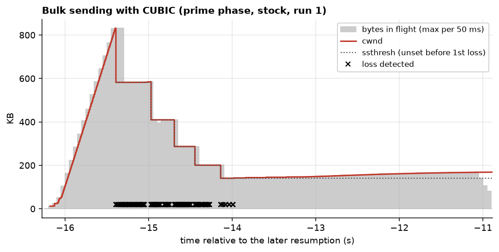
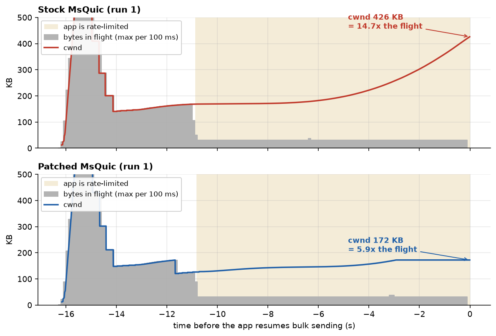
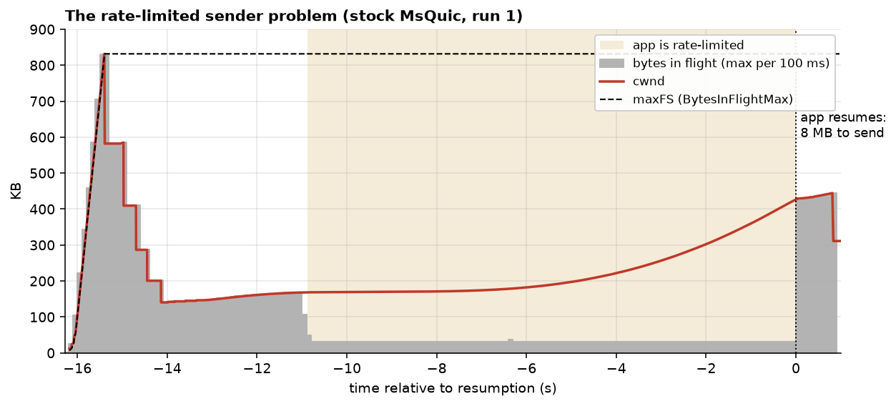
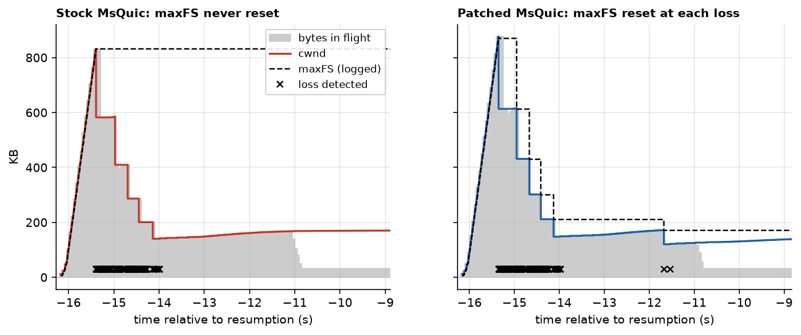
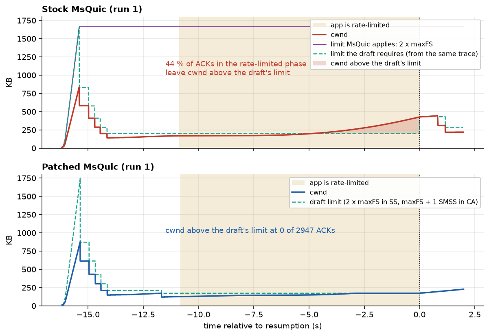
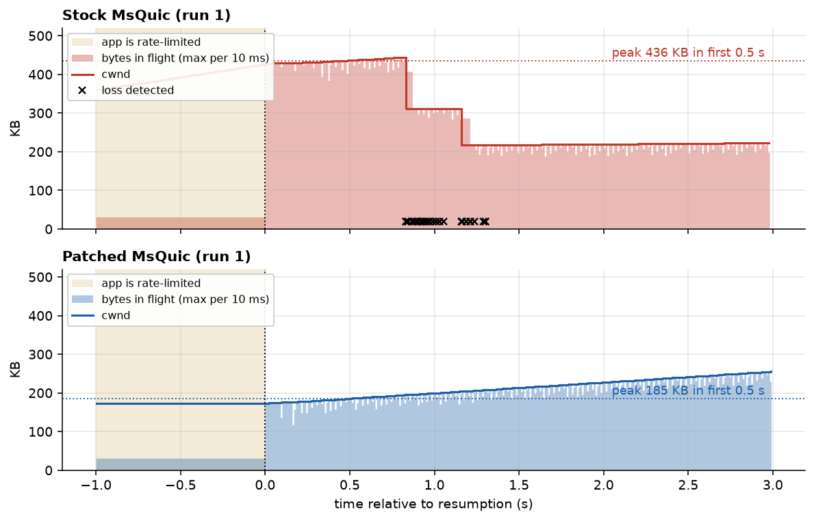
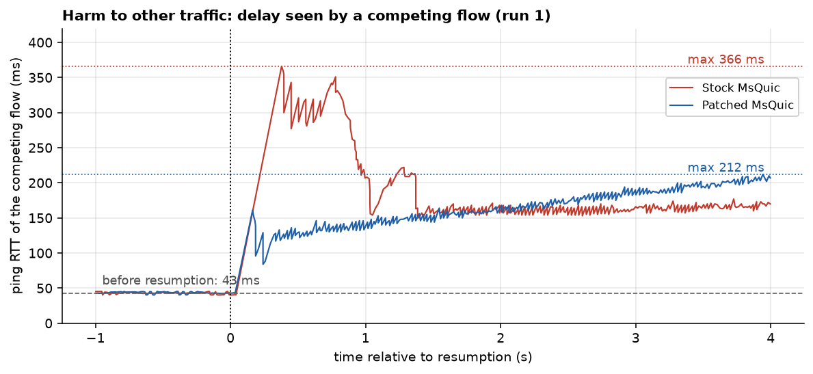
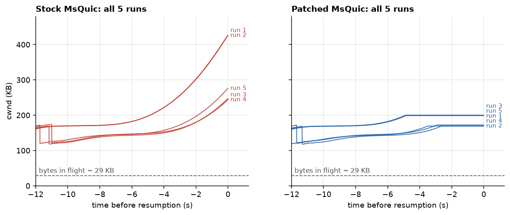
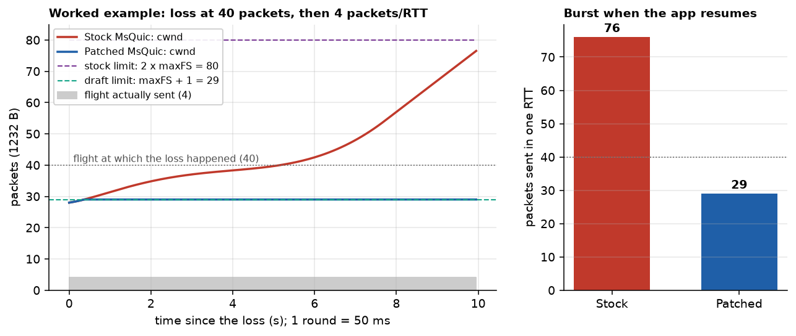

# Experiment graphs

Generated by `experiments/make_experiment_graphs.py` from `experiments/results/` (10 Mbit/s, ~41 ms RTT, 100-packet netem queue) and `report/ablation/traces_all.csv`. Time 0 = the moment the app resumes bulk sending.

> **Note.** These graphs come from the first experiment (5 runs per build, segmentation offloads on). Both builds there still had the upstream AIMD-accumulator underflow that we later fixed (msquic commit `1ca13e9d7`, `patches/0004`). The campaign results with and without that fix are in `report/report.pdf` (Sections 7.2–7.3), produced by `analyze_campaign.py` and `analyze_v3.py`.

## baseline_cwnd.png

CUBIC while the app sends 3 MB as fast as it can: slow start overshoots, losses cut cwnd by 30 % each, and CUBIC then grows it again. Normal, cwnd-limited behaviour.

## ratelimited_cwnd.png

The rate-limited phase (6000 B every 10 ms, ~29 KB in flight). Stock CUBIC keeps growing cwnd on the ACKs of this small flight; the patched sender keeps cwnd tied to what it actually sent.

## rls_problem.png

Whole stock run. During the rate-limited phase cwnd grows far above the flight, and the stock limit 2*maxFS (maxFS = 830 KB from the prime phase) never stops it.

## gap1_before_after.png

Gap 1. After each loss, stock MsQuic keeps maxFS at the pre-loss peak (dashed line stays at ~830 KB). The patch resets it and re-measures it from the flight that is still in the network, so it follows the real flight down.

## cap_before_after.png

Gap 1 + Gap 2 together: the limit on cwnd. Stock MsQuic applies 2 x a stale maxFS, about 1.7 MB, which never binds. The limit the draft requires, computed from the same trace, is far lower. The patched build's cwnd stays on or below the draft's limit.

## resumption_burst.png

What happens when the app resumes. Stock releases its inflated window at once; the queue overflows (x = losses) and cwnd is cut repeatedly. The patched sender starts from a validated window.

## competing_delay.png

A ping every 10 ms shares the bottleneck. The stock burst fills the queue and the ping RTT jumps far more than with the patch.

## ratelimited_all_runs.png

cwnd during the last 12 s of the rate-limited phase in every run. Stock grows in all five (more when the last loss was longer ago); the patched sender stays flat.

## worked_example.png

Deterministic worked example run through MsQuic's own CUBIC code (unit-test harness, scenario A of the report). Stock lets cwnd climb to 76 packets with only 4 in flight.

